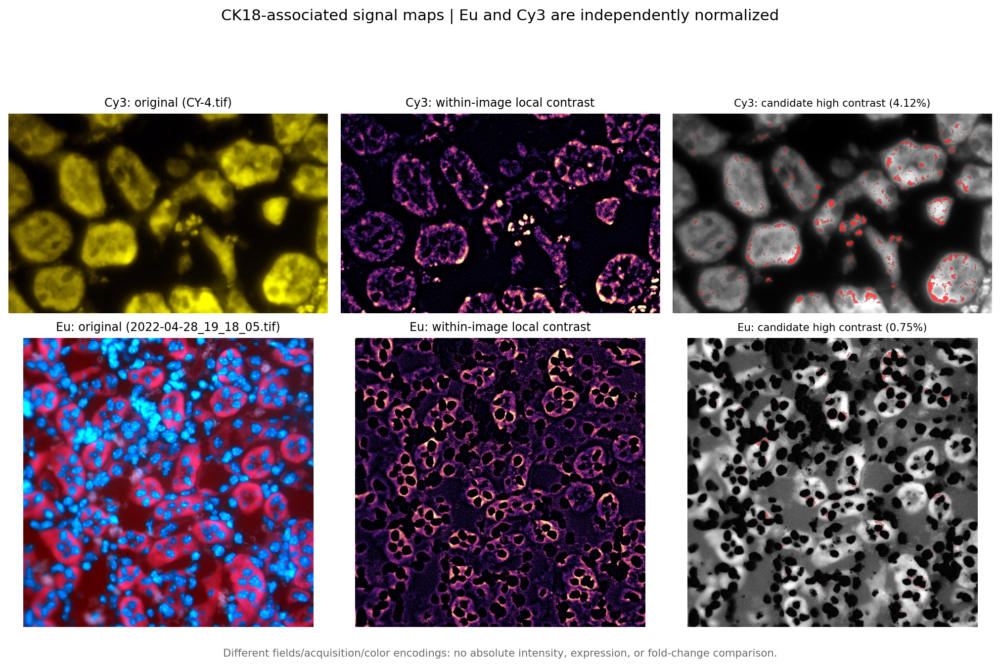
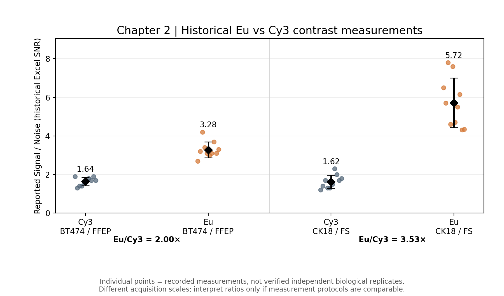

# Lanthanide-IHC | Computational Imaging Analysis

**Reproducible Python workflows for exploratory microscopy-image analysis and auditing historical Eu-versus-Cy3 immunohistochemistry contrast measurements.**

**Related publication:** *High-Contrast Luminescent Immunohistochemistry Using PEGylated Lanthanide Complexes*. **Analytical Chemistry** (2022). [DOI: 10.1021/acs.analchem.2c04058](https://doi.org/10.1021/acs.analchem.2c04058).

> **Scope:** This repository is a **subsequent computational extension** associated with the experimental study. The Python analyses shown here are not presented as methods or results from the original publication.

## Overview

The associated study investigated lanthanide-based luminescent immunohistochemistry. This repository adds small, transparent computational workflows to:

1. **Visualize CK18-associated imaging patterns** from Eu and Cy3 microscopy exports.
2. **Audit microscopy images and specify signal/background regions of interest (ROIs)** for descriptive contrast measurements.
3. **Reproduce descriptive summaries from historical Excel worksheets** containing signal, noise/background, and reported SNR values.

The focus is on traceable analysis and quality control—not automated CK18-positive-cell classification or absolute protein-expression quantification.

## Results at a glance

### 1. CK18-associated Eu and Cy3 signal maps



The panels show an example Cy3 field (top) and a separate Eu field (bottom): original display image, within-image local contrast, and exploratory high-local-contrast candidates. **The fields are not registered and each image is normalized independently.** The example masks contain 4.12% (Cy3) and 0.75% (Eu) selected pixels under the chosen settings. These percentages **must not** be treated as CK18 expression, positive-cell fractions, or a Eu-versus-Cy3 performance comparison.

### 2. Historical Eu-versus-Cy3 contrast measurements



| Historical worksheet group | Cy3: mean recorded SNR | Eu: mean recorded SNR | Ratio of group means (Eu/Cy3) |
|---|---:|---:|---:|
| BT474 / FFEP* | 1.64 | 3.28 | **2.00×** |
| CK18 / FS | 1.62 | 5.72 | **3.53×** |

*“FFEP” reproduces the historical workbook label; specimen-processing terminology requires confirmation.*

Each modality/group contains **10 recorded measurements**, not verified independent biological replicates. The reported metric is labelled “SNR” in the source worksheets and largely corresponds to **Signal / Noise**, where “Noise” may refer to a background intensity. It should not be conflated with a standard-deviation-based contrast-to-noise ratio (CNR).

**Interpretation:** Eu has a higher *recorded* signal/background ratio in these two historical sets. The ratios are **descriptive**, contingent on comparable acquisition and ROI protocols; they are not proof of a causal effect of time gating or a statistically validated improvement.

## Repository structure

```text
.
├── README.md
├── requirements.txt
├── imaging_maps/
│   └── ck18_maps.py
├── contrast_benchmark/
│   ├── ihc_contrast.py
│   └── excel_snr_benchmark.py
└── figures/
    ├── ck18_eu_cy3_side_by_side.png
    └── eu_vs_cy3_historical_snr.png
```

## Installation

Python 3.10+ recommended.

```bash
git clone git@github.com:Great-sophie/Lanthanide-IHC-Computational-Imaging-Analysis.git
cd Lanthanide-IHC-Computational-Imaging-Analysis
python -m pip install -r requirements.txt
```

The microscopy images and source Excel workbooks are **not included**. Set `IHC_DATA` to the local directory containing the `20220428-ihc-cy3` and `20220428-ihc-eu` folders:

```bash
export IHC_DATA="/path/to/SNR on tissue section"
```

### A. Inventory images and Excel files

```bash
python contrast_benchmark/ihc_contrast.py scan \
  --root "$IHC_DATA" \
  --out outputs/inventory
```

This generates an image inventory, representative contact sheet, and spreadsheet list. Folder-derived sample/modality labels must be checked against experimental records.

### B. Generate CK18-associated signal maps

```bash
python imaging_maps/ck18_maps.py scan \
  --root "$IHC_DATA" \
  --out outputs/ck18_inventory

python imaging_maps/ck18_maps.py compare \
  --cy3-image "$IHC_DATA/20220428-ihc-cy3/CK18/CY-4.tif" \
  --eu-image "$IHC_DATA/20220428-ihc-eu/ck18/2022-04-28_19_18_05.tif" \
  --cy3-channel green \
  --eu-channel red \
  --out outputs/ck18_maps
```

**Important:** The file selections and signal-channel assignments are candidate examples. Verify them using original acquisition metadata before interpreting results. The method uses a smoothed local image reference, a robust residual threshold, and border exclusion; it does not identify CK18-positive cells.

### C. Reproduce the historical Excel benchmark

```bash
python contrast_benchmark/excel_snr_benchmark.py \
  --root "$IHC_DATA" \
  --out outputs/excel_snr
```

Expected outputs:

- `measurement_audit.csv` — original Signal, Noise, reported SNR, recalculated Signal/Noise, and rounding-consistency flags.
- `group_summary.csv` — descriptive statistics and audit counts for each historical group.
- `eu_vs_cy3_historical_snr.png` — individual measurements and mean ± SD.
- `interpretation.txt` — results and caveats.

For explicit region-based image measurements, use `contrast_benchmark/ihc_contrast.py inspect` and `measure` with a **manually verified ROI manifest**. Image-derived RGB intensity measures should remain exploratory unless detector-scale calibration and ROI comparability are established.

## Scientific limitations and reproducibility

- **RGB/RGBA exports may be pseudocolored or display-encoded**, rather than linear photon counts. Absolute Eu and Cy3 image intensities are not directly comparable.
- **Eu and Cy3 CK18 example images are different fields**, not spatially registered or known to be paired. Independently normalized maps show spatial patterns only.
- **High-local-contrast masks are heuristic image features**, not validated CK18 segmentation or protein-expression maps.
- **Historical worksheet rows are not verified biological replicates.** No inferential p-values or claims of statistical significance are made.
- **Measurement provenance still requires review:** ROI definitions, acquisition settings, antibody/sample comparability, and whether the repeated Eu BT474 background value of 30 was measured or fixed.
- **Reported-versus-recomputed SNR discrepancies** are flagged in the audit instead of silently corrected.
- A comparison of Eu and Cy3 protocols alone **does not isolate the causal contribution of time gating** without appropriate gated/ungated controls.

All example figures are derived from experimental materials. Confirm rights and permissions before public redistribution. Raw microscopy images, original workbooks, and sensitive sample information are intentionally excluded from the repository.

## Citation

If you use or discuss the experimental method, please cite the associated publication:

*High-Contrast Luminescent Immunohistochemistry Using PEGylated Lanthanide Complexes*. **Analytical Chemistry** (2022). https://doi.org/10.1021/acs.analchem.2c04058

The computational analyses in this repository should be described as **post-publication exploratory extensions** unless independently documented otherwise.
